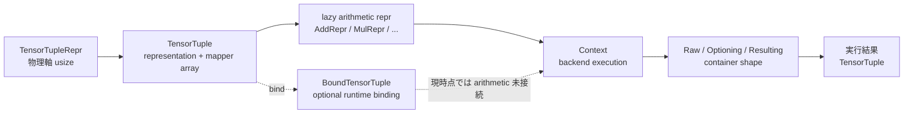

# tensory 現行デザイン

この文書は、現在の作業ツリーに実装されている `repr`、`tensor`、`task`、`container`、`arith` の構造を記録する。将来の API ではなく、現在コンパイルされる core の抽象と、現在有効な arithmetic の構築 API を対象にする。

基本方針は次のとおりである。

- 配列の物理軸は `usize` で扱い、軸の意味は mapper の ID、すなわち leg で表す。
- 数値処理と軸 metadata の処理を分離する。
- arithmetic operator は数値計算を直ちに実行せず、lazy な representation を構築する。
- 実行できる operation と representation の組み合わせだけを backend が `Context` として提供する。
- core は全ての backend に全ての operation の実装を要求しない。



## 1. representation

### 1.1 物理軸の abstraction

`TensorTupleRepr<const N>` は、固定数 `N` 個の tensor representation をまとめる最小の契約である。

```rust
unsafe trait TensorTupleRepr<const N: usize>: Sized {
    fn naxes_array(&self) -> [usize; N];
}
```

representation が公開するのは各 tensor の軸数だけであり、軸 ID や mapper は持たない。したがってこの層では、軸は `0..naxes` の内部 index としてのみ存在する。

`TensorRepr` は `TensorTupleRepr<1>` に対する compatibility bridge であり、単一 tensor の `naxes()` を提供する。現在は `(A, B)` と `(A, B, C)` に対する `TensorTupleRepr<2>` / `TensorTupleRepr<3>` の実装があり、SVD などの複数出力を型付き tuple として保持できる。

### 1.2 representation の不変条件

`TensorTupleRepr` は unsafe trait であり、実装は次の semantic structure を保たなければならない。

- 同じ object の軸数を、mutable operation の前後で変えない。
- 軸の semantic order を、mutable operation の前後で変えない。
- view や owned conversion の前後でも、軸数と semantic order を保つ。

ここでいう semantic order は、representation 内の `usize` 軸 index がどの概念上の軸を指すかという対応である。軸順を変更する operation は、同じ object を mutate するのではなく、新しい representation を by-value で返す。

### 1.3 ownership と view

次の trait が representation の ownership model を表す。

- `AsViewTupleRepr`: immutable view を生成する。
- `AsViewMutTupleRepr`: mutable view を生成する。
- `IntoOwnedTupleRepr`: owned representation に変換する。

これらも unsafe contract を持ち、変換後に semantic structure が変わらないことを要求する。ndarray backend では owned `ArrayD`、immutable `ArrayViewD`、mutable `ArrayViewMutD` などがこの契約を具体化する。

### 1.4 lazy representation も representation である

`AddRepr<L, R>`、`SubRepr<L, R>`、`NegRepr<A>`、scalar operation の representation、contraction の `MulRepr<L, R>` は、まだ数値配列を生成しない。しかし入力 representation と operation metadata を保持し、出力の軸数を返すため、`TensorTupleRepr<1>` を実装する。

つまり representation は「すでに計算された配列」だけでなく、「backend が後で評価できる入力と計算 metadata」を含む lazy expression でもよい。

## 2. tensor と mapper

### 2.1 `TensorTuple` が mapper を所有する

現在の中心型は次である。

```rust
pub struct TensorTuple<const N: usize, R, M> {
    repr: R,
    mappers: [M; N],
}

pub type Tensor<R, M> = TensorTuple<1, R, M>;
```

`TensorTuple` は representation bundle と mapper array を一体で所有する。mapper は representation の外側にあり、物理軸 index と semantic な leg ID の対応を提供する。

tensor が sound であるための基本条件は、全ての `i` について次である。

```text
repr.naxes_array()[i] == mappers[i].naxes()
```

`from_raw` はこの条件を検査し、`from_raw_unchecked` は caller が条件を保証する場合だけ使う。`repr_mut` と `mapper_mut` も semantic structure を壊さないことを caller に要求する。

### 2.2 mapper の責務

`AxisMapper` は、物理軸 index と locally unique な ID の対応を隠蔽する。mapper 自体が守る条件は次である。

- 軸数が固定されている。
- 同一 mapper 内で ID が重複しない。
- index と ID の対応が mutable operation で変わらない。

mapper operation は、数値配列を操作せず、operation に必要な axis metadata を作る。

| mapper operation | metadata | arithmetic / operation での意味 |
| --- | --- | --- |
| `OverlayMapper::overlay` | `OverlayAxisMapping` | 複数入力を同じ leg 順へ揃える |
| `ConnectMapper::connect` | `ConnectAxisOrigin` | 同じ leg の軸を contraction する |
| `GroupMapper::split` | `GroupedAxes` | 軸を query group に分ける |
| `EquivGroupMapper::equiv_split` | `EquivGroupedAxes` | 同じ大きさの group を作る |
| `ReplaceMapper::replace` | 新しい mapper | leg ID を by-value で置換する |

`OverlayAxisMapping` は各入力に対する axis permutation を持つ。`ConnectAxisOrigin` は入力ごとの軸長と、接続された各 endpoint を持つ。backend はこれらを使って配列を並べ替え、数値 primitive に渡す。

### 2.3 tensor input の統一

`ToTensorTuple` と `ToTensor` は sealed conversion trait である。owned tensor、`&Tensor`、`&mut Tensor` を同じ operation input として扱う。

- owned tensor はそのまま消費する。
- `&Tensor` は `view()` から immutable view representation を作る。
- `&mut Tensor` は `view_mut()` から mutable view representation を作る。
- mapper は view 側でも clone され、representation と同じ semantic order を維持する。

この conversion により、arithmetic operator は owned/view/view_mut の組み合わせごとに task を構築できる。複数出力は `TensorTuple<2>` / `TensorTuple<3>` として保持し、`pack` / `unpack` で通常の tensor へ変換できる。

## 3. task と context

### 3.1 task は実行可能な lazy value

`IsTask` は task の marker trait である。arithmetic の lazy representation は `IsTask` を実装し、`TensorTuple` は内部 representation が `IsTask` の場合に task になる。

`TaskExt` は評価の syntax sugar を提供する。

```rust
task.with(context)
task.exec()
```

`with` は指定した context に task を渡し、`exec` は default context `()` を使う。operator overload や `left_mul` / `right_mul` はこの時点では context を呼ばない。

### 3.2 `Context` は backend strategy

`Context<Mk, T>` は task `T` を自分の方法で実行する trait である。

```rust
trait Context<Mk, T> {
    type Output;
    fn execute(self, task: T) -> Self::Output;
}
```

`Mk` は operation family を型レベルで区別する marker である。同時に、第三者 crate が backend implementation を追加するための orphan-rule bridge でもある。

Rust の orphan rule では、foreign trait を foreign type に対して別 crate から実装することは通常できない。`Context<Mk, T>` は `Mk` を trait parameter に持たせることで、backend crate が自分の local marker を渡した実装を定義できるようにする。例えば `tensory-ndarray` は local type `Nd` を marker として使い、foreign type の `()` を context にした次の実装を持てる。

```rust
impl Context<Nd, AddRepr<NdDenseViewRepr<'l, E>, NdDenseViewRepr<'r, E>>> for () {
  // ndarray backend の実行方法
}
```

この場合、`Context` と `()` が backend crate の foreign item であっても、trait parameter の `Nd` が backend crate の local type であるため、許可される実装形にできる。

この一般的な設計手法を **Stepparent Pattern** と呼ぶ。これは `Context` 固有の命名ではなく、次の crate 間の関係全体を指す。

```text
crate A: 型 T を定義する
crate B: trait Trait<M, T> を定義する
crate C: local marker M と impl Trait<M, T> を定義する
```

crate C は crate A の型 T も crate B の trait も所有していない。しかし、自分が所有する marker `M` を trait parameter に差し込むことで、両者を接続する実装を提供できる。実装対象に対して直接の親ではない crate C が、local marker を介して関係を成立させるため **Stepparent** と呼ぶ。

この名前は Rust の公式用語ではなく、orphan rule を満たすための技術的な役割に意図的な比喩を与えたものである。`Context<Mk, T>` における `Mk` は、この一般的な Stepparent Pattern を context execution に適用した local marker である。

context は resource を所有できる。例えば ndarray の default path では `()` を context とし、runtime や追加 option が必要な backend では別の context 型を使える。

### 3.3 tensor-level context bridge

representation 単位の backend 実装を tensor 単位へ持ち上げるために、`ReprContext` と `TensorTupleContext` がある。

処理の概念は次のとおりである。

```text
TensorTuple<N, T, M>
  -> (T, [M; N])
  -> context.execute(T)
  -> container 内の T_out を map
  -> TensorTuple<N, T_out, M>
```

mapper は representation execution に渡さず、task が保持していたものを output tensor に戻す。従って context は、数値 representation と operation metadata から正しい output representation を作る責任を持つが、通常の tensor wrapper を毎回再実装する必要はない。

`ReprContext` は、context が入力の semantic structure を保つ output representation を返すことを表す unsafe marker である。実装者は output representation の軸数と軸順が task の mapper array と一致することを保証する。

### 3.4 runtime-bound tensor

`BoundTensorTuple<N, R, M, RT>` は `TensorTuple` と一つの `Runtime` を保持する Layer 3 の型である。

- `Runtime` は `Clone + Eq` を要求する unsafe marker。
- tuple の全 output は一つの runtime を共有する。
- bound tensor の reference conversion は representation を view にし、runtime を clone する。
- `RuntimeFor<T>` は runtime から task 用 context を作るための拡張点である。

現在の bound tensor では wrapper、bind、view、runtime 保持などの構造は実装されている。arithmetic の bound execution implementation は未接続であり、各 arithmetic file の該当箇所はコメントアウトされている。

## 4. container

container は execution result の外側の型を型レベルで表す。container 自体が計算を行うのではなく、representation result を包む shape を選択する。

| container type | payload `X` に対する型 |
| --- | --- |
| `Raw` | `X` |
| `Optioning<C>` | `Option<C::Container>` |
| `Resulting<C, E>` | `Result<C::Container, E>` |

container はネストできる。例えば `Resulting<Optioning<Raw>, E>` は `Result<Option<X>, E>` になる。

`ContainerImpl<X>` は payload の concrete container type を定義し、`ContainerMapImpl<X, Y>` は container の wrapper を保ったまま payload `X` を `Y` に変換する。

 tensor-level context bridge はこの `map` を使って、backend が返した `Result<RawRepr, E>` を `Result<Tensor<RawRepr, M>, E>` に変換する。成功・失敗や option の伝播を、各 context bridge が手書きで分岐する必要はない。

## 5. arithmetic

### 5.1 設計ルール

core arithmetic は Rust の primitive operator trait を「実行」ではなく「lazy representation の構築」に利用する。

```text
Rust operator
  -> ToTensor
  -> mapper operation
  -> lazy repr + output mapper
  -> Tensor task
  -> .with(context) / .exec()
  -> backend primitive operation
```

入力 mapper の検査と output mapper の生成は task 構築時に行う。数値配列への `Add`、`Sub`、`Mul`、`Div`、`Neg` は backend context の責務である。

### 5.2 現在の lazy representation

| 操作 | lazy representation | 保持する metadata | 現在の core API |
| --- | --- | --- | --- |
| tensor + tensor | `AddRepr<L, R>` | `OverlayAxisMapping<2>` | active |
| tensor - tensor | `SubRepr<L, R>` | `OverlayAxisMapping<2>` | active |
| -tensor | `NegRepr<A>` | 入力軸構造 | active |
| tensor * tensor | `MulRepr<L, R>` | `ConnectAxisOrigin<2>` | active、contraction |
| scalar * tensor | `LeftScalarMulRepr<A, E>` | 入力軸構造と scalar | active |
| tensor * scalar | `RightScalarMulRepr<A, E>` | 入力軸構造と scalar | active |
| tensor / scalar | `RightScalarDivRepr<A, E>` | 入力軸構造と scalar | active |
| scalar / tensor | `LeftScalarDivRepr<A, E>` | 入力軸構造と scalar | representation/extension のみ |
| tensor conjugation | なし | なし | module がコメントアウト |

各 lazy representation は次の構造を持つ。

- 入力 representation を field として所有する。
- operation metadata を field として所有する。
- `TensorTupleRepr<1>` を実装し、出力軸数を metadata または入力から返す。
- `IsTask` を実装する。
- `from_raw` で metadata と入力の軸数を検査する。
- `from_raw_unchecked` は metadata の整合を caller が保証する場合だけ使う。
- `into_raw` で backend context が入力と metadata を取り出せる。

### 5.3 tensor-tensor operation

加算・減算では `OverlayMapper::overlay` を使う。二つの mapper の leg 集合が一致することを確認し、出力 mapper と各入力の permutation を得る。lazy representation はその permutation を保持する。

乗算では通常の要素積ではなく tensor-network contraction を行う。`ConnectMapper::connect` が同じ ID の軸を接続し、残った軸から output mapper を作る。`MulRepr` は `ConnectAxisOrigin<2>` を保持し、backend はその情報から接続軸と非接続軸の順序を決める。

現在、これらの operator は owned/view/view_mut の lhs/rhs 組み合わせを macro で実装している。construction が失敗する場合は mapper error を返す。

### 5.4 scalar operation

`TensorScalar` は現在、bool、整数型、`f32`、`f64` などの primitive scalar type に実装されている。

- scalar の左右を区別するため、mul/div は left/right representation を分ける。
- `tensor * scalar` と scalar tuple `(E,) * tensor` は operator overload から task を構築する。
- `tensor / scalar` は direct scalar `E` と scalar tuple `(E,)` の right division が active。
- left division の representation と extension method はあるが、`(E,) / tensor` の operator 実装は現在無効である。
- scalar operation は mapper の構造を変更せず、入力 mapper をそのまま output tensor に渡す。

`arith/mod.rs` の冒頭コメントには将来候補の operation も列挙されているが、実装済み API の判定は active な module と operator implementation に基づく。

## 6. backend execution boundary

core の arithmetic representation は、backend が実行できることを保証しない。backend は、自分が対応できる representation の具体的な型についてだけ `Context` を実装する。

現在の ndarray arithmetic file で active な代表例は次である。

```rust
impl<'l, 'r, E>
    Context<Nd, AddRepr<NdDenseViewRepr<'l, E>, NdDenseViewRepr<'r, E>>> for ()
{
    type Output = Result<NdDenseRepr<E>, TenalgErr>;
    // axis permutation と ndarray::Zip による加算
}
```

対応する `ReprContext` は `Resulting<Raw, TenalgErr>` を container として宣言する。execution では概ね次を行う。

1. lazy representation から input view と `OverlayAxisMapping` を取り出す。
2. mapping に従って ndarray の axis を permutation する。
3. shape を検査する。
4. `ndarray::Zip` と Rust の primitive `Add` を使って出力配列を作る。
5. container に backend error または output representation を入れる。
6. tensor-level bridge が保存済み mapper と output representation を再結合する。

`sub`、`neg`、scalar arithmetic、contraction の旧 context implementation は現在の `tensory-ndarray/src/arith.rs` ではコメントアウトされている。したがって、core で lazy task を構築できることと、ndarray backend でその task を `.with(())` できることは別である。

この境界により、backend は自分の primitive library、resource、shape制約に合わせて実装可能な task だけを提供できる。全 operation を一括して実装することは core の要件ではない。

## 7. 不変条件と実装規則

新しい representation、mapper、context を追加するときは、次を満たす必要がある。

1. representation の `naxes_array()` と mapper の `naxes()` が全 tuple lane で一致する。
2. mutable operation は semantic axis order を変更しない。
3. mapper metadata の permutation、endpoint、group が入力軸を完全に表す。
4. lazy representation の output axis structure と output mapper が一致する。
5. backend context は対応する具体的な input representation に対してだけ実装する。
6. `unsafe` constructor は、検証済みの metadata を渡す箇所に限定する。
7. error は可能な限り construction-time の mapper error と execution-time の backend/context error に分ける。
8. container mapping では `Option` / `Result` の wrapper を失わない。

特に、backend は output 配列を作るだけでは不十分である。task 構築時に決まった semantic axis order と、backend 内部の ndarray axis order の対応を `OverlayAxisMapping` または `ConnectAxisOrigin` に従って保つ必要がある。

## 8. 現在の制限

- bound tensor の arithmetic execution は未接続で、関連実装はコメントアウトされている。
- ndarray の arithmetic execution は現時点で限定的で、`AddRepr` の context が active な代表実装である。
- core の lazy constructor の存在は、対応する backend context の存在を意味しない。
- `scalar / tensor` の operator overload は未接続である。
- conjugation module は active ではない。
- container は result shape の抽象であり、retry、stream、task scheduling、fusion を提供しない。
- lazy representation は型付き expression tree だが、現時点で自動的な graph optimizer や operation fusion は定義されていない。

従って現在の設計は、次の順序で拡張するのが自然である。

```text
core に lazy repr と mapper contract を追加
  -> backend が実行可能な具体型に Context / ReprContext を追加
  -> container と tensor bridge で結果を再構成
  -> 必要になった段階で runtime-bound execution を接続
```

## 9. 要約

`repr` は物理軸と ownership を表し、`tensor` はそれに mapper を加えて semantic leg structure を表す。`task` はその tensor operation を lazy value として保持し、`Context` が backend-specific に評価する。`container` は evaluation result の外側の型を保ったまま tensor wrapper を再構成する。`arith` は Rust の primitive operator trait を利用して lazy representation を作り、数値計算そのものは backend に委譲する。

この分離により、core は軸の意味と operation metadata を静的に保持しつつ、backend は実行可能な representation の組み合わせだけを実装できる。
