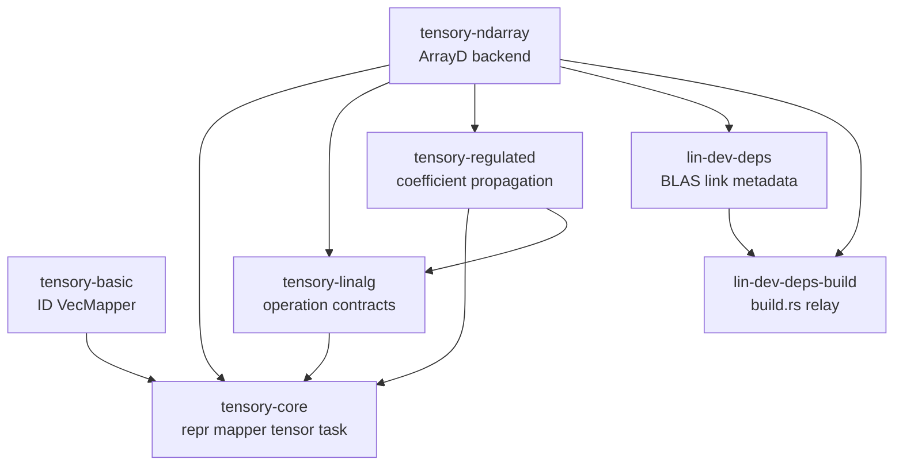

# tensory 現行構造メモ

## 0. 調査方針とスナップショット

この文書は、README、`develop.md`、`develop.ai.md` の説明ではなく、現在の作業ツリーにある Rust source と Cargo manifest を読んで整理したものです。既存文書は現行実装を正確には反映していないため、設計意図の引用元として扱いません。

調査時点の Git 状態は次のとおりです。

- branch: `llm-work`
- HEAD: `06ef5cd`
- worktree: dirty
- `tensory-core/src/assign.rs` と `experiments/dyload/src/lib.rs` / `src/bin/main.rs` は未追跡の追加ファイル
- 旧 `experiments/dyload/src/blas.rs` と `src/main.rs` は削除状態
- core、basic、linalg、ndarray、regulated、および複数の example は HEAD から変更されている

したがって、以下は commit 済みの設計書ではなく、HEAD と作業ツリーの差分を含む「いま存在する構造」の説明です。

## 1. 全体像

tensory は、軸を単なる配列位置ではなく局所的に一意な ID (`leg`) として扱う tensor-network 用 Rust library です。数値データを直接操作する層と、軸の意味を操作する層、実行 backend を選択する層が分離されています。

中心となる分割は次の3層です。

1. **Layer 1: representation**
   - データと、内部 `usize` 軸だけを持つ `TensorTupleRepr<N>`。
   - 配列の軸数、view、owned 化だけを抽象化する。
2. **Layer 2: tensor**
   - representation と `AxisMapper` を組み合わせた `Tensor`。
   - mapper が `usize` 軸と局所 ID (`leg`) の対応を保持する。
   - tensor-network の接続、overlay、軸 grouping はこの層で記述する。
3. **Layer 3: bound tensor**
   - Layer 2 の tensor に `Runtime` を束縛した `BoundTensor` / `BoundTensorTuple`。
   - backend context を毎回 `.with(ctx)` に渡さずに実行できる高水準 API を提供する。

演算は原則として eager な数値処理ではなく、軸 metadata を先に確定した `TensorTask<C>` として作られます。task が `C` の context に representation の演算を委譲し、backend は同じ task API に対する context implementation として差し替えられます。

## 2. Workspace と依存方向

root の [Cargo.toml](Cargo.toml) は resolver 3、edition 2024、workspace version `0.2.0` を指定しています。workspace member は次のとおりです。

```text
tensory-core
tensory-basic
tensory-linalg
tensory-ndarray
tensory-regulated
lin-dev-deps
lin-dev-deps-build
examples/*
experiments/*
```

`experiments/numpy` だけは workspace から exclude されています。

主な依存方向は次のとおりです。



依存の責務は以下です。

- `tensory-core`: backend 非依存の tensor、mapper、task、算術契約。
- `tensory-basic`: 実用的な ID と vector-backed mapper。
- `tensory-linalg`: SVD、QR、固有値などの lazy operation 契約。数値ライブラリは直接依存しない。
- `tensory-ndarray`: `ndarray::ArrayD` と `ndarray-linalg` を使う具体 backend。
- `tensory-regulated`: tensor 本体とスケール係数を分けて扱う拡張層。
- `lin-dev-deps`: `links = "linalg-backend"` を持つ BLAS backend の依存 crate。
- `lin-dev-deps-build`: `DEP_LINALG_BACKEND_LINKARG` を downstream の rustc link argument へ転送する小さな build helper。

root workspace dependency には `ndarray`、`ndarray-linalg`、`blas-src`、`rand`、`libloading`、`pkg-config`、`bimap`、`itertools` などがあり、root の `[patch.crates-io]` で `blas-src` は `thin-mkl` branch、`intel-mkl-src` は `pkg-config` branch に差し替えられています。

## 3. Core の抽象

### 3.1 Representation (`tensory-core/src/repr.rs`)

`TensorTupleRepr<const N>` は、1個または固定数 `N` 個の representation をまとめる最小 interface です。各 representation の軸数を `[usize; N]` で返します。

`TensorRepr` は `TensorTupleRepr<1>` に対する blanket implementation で、単一 tensor の軸数を扱います。2個・3個の tuple に対する `TensorTupleRepr<2>` / `<3>` も定義されており、SVD、QR、固有値分解の複数出力を型で保持します。

representation 系には次の view/ownership 契約があります。

- `AsViewRepr` / `AsViewTupleRepr`: immutable view を作る。
- `AsViewMutRepr` / `AsViewMutTupleRepr`: mutable view を作る。
- `IntoOwnedRepr` / `IntoOwnedTupleRepr`: owned representation に変換する。

これらの trait は軸数と軸の semantic order を保持する責任を unsafe contract として要求します。実際の配列 stride やメモリ管理は backend 側が決めます。

### 3.2 Mapper (`tensory-core/src/mapper.rs`)

`AxisMapper` は内部軸 index と ID の対応を隠蔽し、`naxes()` と `Id` 型だけを公開します。mapper と representation は、同じ軸数を持つ組としてはじめて sound な tensor になります。

軸操作の metadata は次のように型分けされています。

- `OverlayMapper`: 複数 mapper の同じ ID 軸を同じ出力軸へ揃える。`OverlayAxisMapping` が各入力の permutation を持つ。
- `ConnectMapper`: 同じ ID を持つ軸を contraction し、`ConnectAxisOrigin` が入力 tensor と入力軸 index の接続を記録する。
- `GroupMapper`: 指定した軸集合を group と残りの group に分け、`GroupedAxes` を返す。
- `EquivGroupMapper`: 行列の左右のように、等価な大きさで組にすべき axis group を作り、`EquivGroupedAxes` を返す。
- `DecompGroupedMapper`: grouped axes と新しい bond ID を固定数の出力 mapper に分解する。SVD、QR、Eig の出力 schema を作る。
- `SolveGroupedMapper`: grouped axes の各 group を複数出力へコピーする。固有方程式 solver の schema を作る。
- `ReplaceMapper`: ID を置換する。
- `SortMapper`: ID に対応する外部値を mapper の内部順序へ並べ替える。

`GroupedAxes`、`EquivGroupedAxes`、`OverlayAxisMapping`、`ConnectAxisOrigin` には validated constructor と `from_raw_unchecked` があり、backend task に渡る metadata の不変条件を表現しています。

### 3.3 Tensor (`tensory-core/src/tensor.rs`)

`TensorTuple<N, R, M>` は `repr: R` と `[M; N]` を保持します。`Tensor<R, M>` は `TensorTuple<1, R, M>` の alias です。

主な API は次のとおりです。

- `from_raw` / `from_raw_unchecked`: representation と mapper の軸数整合を検査または caller に委ねる。
- `view` / `view_mut` / `into_owned`: representation の ownership model を変える。
- `replace_leg`: mapper の ID だけを by-value で置換する。
- `TensorTuple<2/3>::into_tensors`: 複数出力 tuple を通常の tensor へ分解する。
- `ToTensor`: owned tensor、`&Tensor`、`&mut Tensor` を共通の task 入力へ変換する sealed trait。

`TensorTask<C>` は task の実行契約です。`TensorDefaultTask` の `.exec()` は context `()` を使い、backend 固有 resource が不要なデフォルト実装を簡略化します。`&tensor` は通常 `view()` に変換されるため、non-consuming な利用は backend の view representation によって実現されています。

### 3.4 Runtime-bound tensor (`tensory-core/src/bound_tensor.rs`)

`Runtime` は `Clone + Eq` を要求する unsafe marker trait です。`BoundTensor` は tensor と runtime を一体で保持し、`BoundTensorTuple` は複数出力で1つの runtime を共有します。

`ToBoundTensor` は owned、shared reference、mutable reference を view へ変換する sealed trait です。bound operation は `RuntimeErr` により、axis error、context error、runtime mismatch を区別します。

現在の `tensory-ndarray` runtime は state-less な `NdRuntime` です。実際の ndarray backend の context は `()` または option を内包する型であり、将来 resource handle を runtime に持たせる余地を残した構造です。

## 4. 軸 ID と mapper の実装

[tensory-basic/src/id.rs](tensory-basic/src/id.rs) は次の ID 型を提供します。

- `Id128`: UUID v4 を内部に持つ ID。
- `Tag`: 文字列 tag。
- `Prime<Id>`: 元の ID に prime level を付けた ID。`prime()`、`prime_by()` で同じ物理的 leg の別 copy を表す。

[tensory-basic/src/mapper.rs](tensory-basic/src/mapper.rs) の `VecMapper<T>` は ID を `Vec<T>` の順序で保持します。

- `from_raw` は ID の重複を検査する。
- `BuildableMapper` は ID iterator から作る。
- `SynBuildableMapper` は `[[Id; N]]` を flatten して、`eye` や Hermitian tensor の paired IDs を作る。
- `overlay` は両 mapper の軸数と ID 集合を検査し、rhs permutation を作る。
- `connect` は同一 ID の軸を対にして contraction origin を作る。
- `split` は指定された軸を first group、残りを second group にする。指定漏れはエラーにせず残り group に入る仕様になっている。
- `equiv_split` は入力軸数が pair 数の2倍であることと、全 ID が見つかることを要求する。
- `SplitMapper` が後段の `decomp` / `solve` を受け持つ。

`VecMapper` の mapper operation の多くは `Infallible` または小さな error type を返し、計算結果の shape/軸検査は backend へ渡る前の metadata 段階でできるだけ済ませます。

## 5. 引数 macro と典型的な軸記法

[tensory-core/src/args.rs](tensory-core/src/args.rs) の macro は API 呼び出しを読みやすくするためのものです。

- `lm![leg => size, ...]`: ID と dimension の map。
- `ls![leg, ...]`: axis group/query。
- `leg![...]`: leg 引数を組み立てる補助 macro。

例えば `ls![&a, &b]` は SVD の左側 group を表し、`ls![(&a, &a.prime()), (&b, &b.prime())]` は square/equivalent な左右 axis pair を表します。ID 自体は backend の array axis に直接保存されず、mapper が array axis index を意味のある leg へ翻訳します。

## 6. Arithmetic と assignment

### 6.1 Core の operation contract

[tensory-core/src/arith](tensory-core/src/arith) は operation ごとに context trait、task、`ToTensor` 向け extension、runtime 向け extension を定義します。

現在の主な対象は次のとおりです。

- `AddCtxImpl` / `SubCtxImpl`: overlay metadata に沿った tensor 加算・減算。
- `MulCtxImpl`: 共通 ID を contraction する tensor-tensor multiplication。
- `NegCtx`: unary negation。
- `LeftScalarMulCtx` / `RightScalarMulCtx`: 左右 scalar multiplication。
- `CommutativeScalarMulCtx` / `CommutativeScalarDivCtx`: scalar multiplication/division と runtime factory。

core は `a * b` を通常の要素積ではなく network contraction として扱います。scalar 演算と tensor-tensor 演算を別 context trait にしたことで、backend は同じ mapper schema に対して異なる numeric implementation を提供できます。

### 6.2 ndarray arithmetic

[tensory-ndarray/src/arith.rs](tensory-ndarray/src/arith.rs) は ndarray view を入力とする具体 implementation です。

- add/sub: `OverlayAxisMapping` の permutation で両配列を同じ軸順にして `ndarray::Zip`。
- contraction: `ConnectAxisOrigin` から lhs/rhs の contraction 軸を抽出し、非接続軸と接続軸を並べ替えて `tenalg::mul` へ渡す。
- scalar/neg: `ArrayD` の ndarray 演算。
- default numeric context: `()`。
- runtime context: `NdRuntime` が `()` を生成する。

`tenalg::mul` は、lhs の末尾 `concat_dim` 軸と rhs の先頭 `concat_dim` 軸を matching dimension として行列化し、dot した後に tensor shape へ戻します。したがって contraction の順序は mapper が決め、数値計算そのものは行列積へ還元されます。

### 6.3 Assignment

作業ツリーで追加された [tensory-core/src/assign.rs](tensory-core/src/assign.rs) は、既存 destination representation へ lazy tensor を書き込む `AssignCtx` と `TensorAssign` を定義します。`Tensor::assign(destination)` は source task と destination representation をまとめ、context 実装が `assign_unchecked` を行う形です。

現時点では core に契約と task はありますが、ndarray backend 側の `AssignCtx` 実装は確認できません。したがって、assignment は「core API の追加途中」であり、[examples/ideal/src/main.rs](examples/ideal/src/main.rs) の古い想定にある実行可能な ndarray assignment と同一視できません。

## 7. Linear algebra layer

[tensory-linalg/src/lib.rs](tensory-linalg/src/lib.rs) は数値 backend を持たない lazy API 層です。operation ごとに unsafe な raw context trait と、axis 数だけを検査する safe wrapper を持ちます。実装 task は多くの場合、構築時に mapper output schema を作り、実行時に `*_unchecked` を backend context へ呼びます。

| module | 入力軸 metadata | 出力 | 現在の主な backend/context |
| --- | --- | --- | --- |
| `svd.rs` | `GroupedAxes<2>`。query group と rest | `U`, `S`, `V` の3 tensor。`S` は diagonal | `()`, `CutFilter`, `NdRuntime` の option runtime |
| `qr.rs` | `GroupedAxes<2>` | `Q`, `R` の2 tensor | ndarray の `()` |
| `eig.rs` | `EquivGroupedAxes<2>`。square/Hermitian pair | `V`, `D`, `VC` | ndarray の `Hermite` |
| `solve_eig.rs` | `EquivGroupedAxes<2>` | `V`, `D` | ndarray の `()`。complex 出力 |
| `exp.rs` | `EquivGroupedAxes<2>` | 元の軸 schema を保つ tensor | ndarray の `Diag` |
| `pow.rs` | `EquivGroupedAxes<2>` | 元の軸 schema を保つ tensor | `Diag`, `(Diag, PowF)`, `(Diag, PowI)` |
| `norm.rs` | 軸 metadata 不要 | scalar norm | ndarray の `()`。L2 norm |
| `conj.rs` | 軸 metadata を保持 | 同じ軸構造の conjugate tensor | ndarray の `()` |
| `det.rs` | 未実装 | なし | 空ファイル |
| `lu.rs` | 未実装 | なし | 空ファイル |

### 7.1 SVD と QR

`TensorSvdExt::svd` / `svd_with_more_ids` は、入力 axes を U 側と V 側へ分け、分解で新しく生じる bond ID を指定します。例えば入力 `[a,b,c,d]` を `[a,b] | [c,d]` に分けると、概念上は次になります。

```text
U: [a,b,us]
S: [us,sv]
V: [sv,c,d]
```

`svd` の shorthand は `us` と `sv` に同じ ID を使います。`svd_with_more_ids` は U-S と S-V の bond ID を分けられます。

QR も同様に query group と rest group を split し、Q-R の新しい bond ID を指定します。

### 7.2 固有値操作

`eig`、`solve_eig`、diagonal `exp`、`pow` は `EquivGroupedAxes<2>` を要求します。つまり単に二つの group に分けるだけでなく、左右 group が同じ長さ・概念上対応する square matrix であることを mapper schema で表します。

- `eig` の ndarray `Hermite` context は `eigh` を使う。出力は固有ベクトル、real diagonal tensor、conjugate 側。
- `solve_eig` は一般固有値問題を `eig` で解き、complex の `D` と `V` を返す。出力順は backend の `(D,V)` を task が `[V,D]` に戻す。
- `exp` は `diag_map` で diagonal tensor の各 diagonal 要素に `exp` を適用する。
- `pow` は同じ `diag_map` を使い、scalar `E`、`E::Real`、`i32`、marker `Half` に対する実装がある。

linear algebra の prelude では SVD、QR、Eig、SolveEig、Norm、Conj、Exp、Pow の extension が公開されています。ただし bound 版は現在 SVD、Norm、Exp、Pow が中心で、bound QR/Eig/SolveEig/Conj は prelude で無効化されています。

### 7.3 Singular-value filter

[tensory-ndarray/src/tenalg/cut_filter.rs](tensory-ndarray/src/tenalg/cut_filter.rs) の `CutFilter` は SVD の `S` を検査し、U/S/V を同じ rank で切り詰めます。

- `min_ix`: 最低 rank。
- `max_ix`: 最大 rank。
- `cutoff`: 末尾 singular value の二乗和に基づく cutoff。
- `max_ix`、`min_ix`、`clamp_ix`、`cutoff_sq` は filter を簡単に作る helper。

filter は singular values が非負で降順であることも確認し、異常なら `TenalgErr::InvalidResult` を返します。

## 8. ndarray backend

### 8.1 Representation と constructor

[tensory-ndarray/src/lib.rs](tensory-ndarray/src/lib.rs) の representation は以下です。

- `NdDenseRepr<E>`: owned `ndarray::ArrayD<E>`。
- `NdDenseViewRepr<'a, E>`: immutable `ArrayViewD`。
- `NdDenseViewMutRepr<'a, E>`: mutable `ArrayViewMutD`。
- `NdDenseCowRepr<'a, E>`: `CowArray`。

それぞれに `TensorTupleRepr<1>`、axis size の `AxisInfoReprImpl`、可能なものには view/owned conversion が実装されています。owned repr は element access と mutable element access も持ちます。

`NdDenseTensorExt` は mapper を構築して次を提供します。

- `from_array`
- `zero`、`scalar`
- `random`、`random_using`
- `random_hermite`、`random_hermite_using`
- `random_unitary`、`random_unitary_using`
- `eye`
- `map`

paired ID を受け取る constructor は `SynBuildableMapper` を利用し、配列の前半/後半に対応する axis を作ります。`NdRuntime` は state-less runtime marker です。

### 8.2 Tensor-to-matrix conversion

[tensory-ndarray/src/tenalg/convert.rs](tensory-ndarray/src/tenalg/convert.rs) の `ten_to_mat` / `mat_to_ten` は `Order::ColumnMajor` を明示して shape を変換します。

backend の基本手順は次です。

1. mapper の group metadata から入力軸 permutation を作る。
2. `ArrayViewD::permuted_axes` で左側軸、右側軸、または contraction 軸を連続した位置へ移す。
3. column-major reshape で2次元 matrix にする。
4. `ndarray-linalg` の BLAS/LAPACK operation または ndarray dot を呼ぶ。
5. 結果 matrix を元の output axis sizes へ column-major reshape する。
6. task 構築時に作った output mapper と組み合わせて `Tensor` に戻す。

[tensory-ndarray/src/tenalg/mod.rs](tensory-ndarray/src/tenalg/mod.rs) はこの変換を使って、conjugate、contraction、SVD、QR、eig、一般 eig、diagonal map を実装しています。数値 primitive は `ndarray-linalg::{SVD, SVDDC, QR, Eig, EighInto}` や `ArrayBase::dot` に委譲されます。

### 8.3 Error

[tensory-ndarray/src/tenalg/error.rs](tensory-ndarray/src/tenalg/error.rs) の `TenalgErr` は shape error、ndarray-linalg error、無効入力、無効結果を backend 境界でまとめます。mapper 側の error と backend 側の error は別に保持され、bound API では `RuntimeErr::Axis` / `RuntimeErr::Ctx` に包まれます。

## 9. Regulated layer

[tensory-regulated/src/lib.rs](tensory-regulated/src/lib.rs) は `#![no_std]` の係数付き tensor abstraction です。

### 9.1 表現

```text
RegulatedRepr<A, C, N> = normalized representation A
                         + coefficient representation C
                         + regulation marker N
```

`Regulation` が係数 scalar type を決め、`Regulator<A>` が representation を正規化して `(normalized_repr, scalar)` を返します。`CoefficientRepr` は scalar を直接保持しても、対数などの安定な形で保持してもよい契約です。

現在の coefficient API は次のとおりです。

- `build(scalar)`: normalizer が返した scalar を係数へ入れる。
- `merge([coeff...])`: tensor-tensor multiplication などで係数を合成する。
- `mul(coeffs)` / `div(coeffs)`: scalar 演算による係数更新。
- `factorize([coeff...])`: 加算前に共通係数と各入力の相対 scalar へ分ける。
- `unpack()`: `Inflator` で normal tensor に戻すための実 scalar。

### 9.2 ndarray の concrete regulation

[tensory-ndarray/src/regulated.rs](tensory-ndarray/src/regulated.rs) は次を提供します。

- `L2Regulator<E>`: L2 norm で配列を割り、norm を係数へ移す。
- `Inflator`: 保存した係数を normalized array に掛けて復元する。
- `LnCoeff<E>`: 係数を `ln(value)` として保持する。merge は log の和、mul/div は log の加減、factorize は最大 log を共通係数にする。
- `WeightedAddCtxImpl` for `()`: common coefficient と相対係数で二つの ndarray view を weighted add/sub する。

### 9.3 演算の係数伝播

[tensory-regulated/src/arith.rs](tensory-regulated/src/arith.rs) の `RegulatedCtx<C>` は通常の core context を包みます。

- `mul`: 入力係数を `merge` し、representation の積を正規化し、追加で生じた係数を `mul` する。
- `add` / `sub`: 入力係数を `factorize` し、相対係数を ndarray weighted operation に渡し、結果を再正規化する。
- 左右 scalar multiplication: scalar を `ScalarRegulator` で phase/係数へ分離し、representation には phase だけを適用する。

[tensory-regulated/src/linalg.rs](tensory-regulated/src/linalg.rs) の現行実装は SVD を対象にしています。入力係数は SVD の S 側へ移し、U/S/V 各 representation を個別に regulate します。これにより normalized factor の積と元 tensor の係数が一致するようにしています。

`RegulatedTensorExt` の `into_inner_tensor` は normalized representation と coefficient を分離し、`into_normal_tensor` は `UnpackableCoefficientRepr + Inflator` を使って通常 tensor に戻します。`TensorRegulatedTask` と `TensorDefaultRegulatedTask` により、通常の `.with(ctx)` / `.exec()` に似た形で regulated task を評価できます。

### 9.4 テストの位置づけ

[tensory-regulated/tests/lib_test.rs](tensory-regulated/tests/lib_test.rs) には、通常 tensor と regulated tensor の contraction、加算、SVD 復元を比較する active test があります。ファイル後半には旧 API を使った大規模なコメントアウト試作も残っているため、コメントコードは現在の実行可能な API とは区別する必要があります。

## 10. BLAS / LAPACK と開発環境

### 10.1 現在の backend 選択

[lin-dev-deps/Cargo.toml](lin-dev-deps/Cargo.toml) は現状 `blas-src` の `openblas` feature と `openblas-src` の `system` feature を有効にしています。したがって標準の development/test 経路は、system OpenBLAS が利用可能であることを前提にしています。Accelerate、Intel MKL、BLIS、Netlib、R は manifest 内にコメントとして残っている候補で、同時に有効な選択肢ではありません。

`tensory-ndarray` の feature `__test-build` は `lin-dev-deps` と `lin-dev-deps-build` を依存へ追加します。test build では [tensory-ndarray/build.rs](tensory-ndarray/build.rs) が `lin_dev_deps_build::build()` を呼び、feature 無しの test compile は `compile_error!` になります。

`lin-dev-deps-build` は environment variable `DEP_LINALG_BACKEND_LINKARG` を読み、`cargo::rustc-link-arg` として伝搬します。examples と experiments の build.rs もこの helper を呼ぶため、BLAS link 設定が各 package に分散しないようになっています。

[.cargo/config.toml](.cargo/config.toml) には macOS Accelerate 用の rustflags がコメントで残っていますが、現行の有効設定ではありません。

### 10.2 Nix shell

[flake.nix](flake.nix) は nixpkgs `nixos-25.11`、rust overlay、個人 overlay を使う devShell を定義します。主な package は以下です。

- stable latest Rust と `rust-src`
- `cargo-edit`
- system BLAS 用 `openblas`
- `pkg-config`
- `uv`、Python 3.13
- `sccache`

この設定は OpenBLAS、Rust、Python benchmark、cache を一つの開発環境に揃えるためのもので、library 自体は core 層で `no_std` を維持します。

## 11. examples

### 11.1 `examples/usage`

[examples/usage/Cargo.toml](examples/usage/Cargo.toml) は全主要 crate と BLAS/test helper に依存します。

- `usage-core-1-schema.rs`: `NdDenseTensor` を作り、scalar multiply/divide、subtract、norm を lazy task と `.with(())` / `.exec()` で評価する基本例。`&tensor` が view へ変換されることも説明する。
- `usage-core-2-runtime.rs`: tensor を `NdRuntime` に bind し、bound tensor API で context を明示せずに演算する例。runtime/bound 層が発展中であることも source 内に明記されている。
- `usage-linalg.rs`: norm、diagonal sqrt/pow/exp、conjugate、SVD、QR、Hermitian eig、general eig solve の reconstruction/error check。
- `benchmark.rs`: 軸 permutation を全探索し、`10*20*30*40` tensor の SVD を100回測り、行列化後の期待演算量と時間比を出力する。

### 11.2 `examples/algorithms`

- `btree.rs`: 空の `main`。実装済み example ではない。
- `ctmrg.rs`: 2次元 Ising 型 tensor を作り、SVD と `max_ix` による bond truncation を用いた corner transfer / renormalization の試作。自由エネルギー密度を出力する。
- `dmrg.rs`: MPS/MPO-like tensor 列、left/right environment、center SVD、bond truncation を含む DMRG の骨格。Hamiltonian は zero tensor で、実際の局所最適化部分は未実装の試作段階。
- `trg.rs`: regulated layer を使わない tensor renormalization group。各反復で二方向 SVD、tensor contraction、norm による手動再正規化、partition function の log を計算する。
- `trg-regulated.rs`: `L2Regulator` と `LnCoeff` を使い、係数を tensor 本体から分離した TRG。最後に coefficient の log と core scalar を合算する。
- `trg-hand-regulated.rs`: regulated abstraction を使わず、norm と `coeff_log` を手作業で追跡する比較用 TRG。

各 algorithm example は現行 API の使い方を検証する実験コードであり、完成した solver/package の境界は持っていません。

### 11.3 `examples/ideal`

[examples/ideal/src/main.rs](examples/ideal/src/main.rs) は現在の API から外れた古い設計スケッチです。`CoreAlloc`、`BlasHandle`、`DenseTensor`、`CuTensor` など現行 workspace にない名前を使用し、同じ file に `main` が二つあります。workspace member ではありますが、現行の `tensory-core` / `tensory-ndarray` の利用例としては実行可能な状態ではありません。

## 12. experiments

### 12.1 `experiments/ndarray`

`ndarray-performance-test` は tensory wrapper を使わず、`ndarray-linalg` の SVD API を比較する benchmark package です。`SVD`、`SVDDC`、truncated SVD の実行時間を測り、複数の BLAS backend 実行結果を `svd.*.out` に保存しています。build.rs は `lin-dev-deps-build` を呼びます。

### 12.2 `experiments/numpy`

workspace 外の Python experiment です。[experiments/numpy/pyproject.toml](experiments/numpy/pyproject.toml) は Python `>=3.13`、NumPy `>=2.3.3`、SciPy `>=1.16.2` を指定します。[svd.py](experiments/numpy/svd.py) は SciPy の `gesvd` / `gesdd` と thin/full matrix SVD を比較します。`.venv`、`uv.lock`、出力ファイルも存在しますが、Cargo workspace member ではありません。

### 12.3 `experiments/dyload`

package name は `dyload-test` です。

- [experiments/dyload/src/lib.rs](experiments/dyload/src/lib.rs): Fortran BLAS の Level 1/2/3 function pointer type alias を `#![no_std]` で定義する低レベル FFI 型集。`DgemmFn` を含み、BLAS function を実際にロードする loader 本体ではない。
- [experiments/dyload/src/bin/main.rs](experiments/dyload/src/bin/main.rs): `pkg-config` で OpenBLAS の library path を探し、`libloading` で `dgemm_` と `openblas_get_config` をロードする実験。手書き三重ループの GEMM と比較し、config string も表示する。

この実験は「runtime に BLAS を dynamic load する」という方向の proof of concept で、`tensory-ndarray` の通常 backend と統合されていません。旧ファイルの削除と新しい `src/bin` / `src/lib.rs` の追加が同じ dirty worktree にあるため、歴史的な構造と現行構造を混同しないことが重要です。

## 13. 現在の未実装・注意点

現行 source から確認できる、構造上の未完了部分は次です。

- `tensory-linalg/src/det.rs` と `lu.rs` は空で、module 宣言だけがある。
- `tensory-linalg` の bound QR/Eig/SolveEig/Conj API は未接続または prelude から外れている。
- `tensory-core/src/assign.rs` は task/context 契約の追加途中で、ndarray の assign context はまだない。
- `tensory-core/src/arith/trace.rs` は whitespace のみ。
- `tensory-core/src/veccy.rs` は `Arrayiy` の検討用コードで、実際の tensor path には使われていない。
- regulated test file には旧 API のコメントアウト試作が大量に残っている。
- `examples/algorithms/src/bin/btree.rs` は空。
- `examples/ideal` は古い API と duplicate `main` を含む。
- backend は `unsafe` context trait の実装者が axis provenance と出力 schema を正しく守ることを前提にしている。raw constructor と unchecked method が多いため、新しい backend/context を追加するときは metadata と shape の対応が最重要になる。
- `VecMapper::split` は query にない軸を残り group へ送る。一方、`equiv_split` は全軸を pair query で指定する。両者の error semantics は同じではない。

## 14. 典型的な実行フロー

現行の ndarray SVD を例にすると、コードの流れは次です。

```text
NdDenseTensor::random(lm![...])
  -> NdDenseRepr<ArrayD> + VecMapper<Id>
  -> (&tensor).svd(query, new_bond_ids)
  -> mapper split/group + output mapper decomposition
  -> TensorSvd task
  -> .with(()) / .with(CutFilter) / bound runtime option
  -> NdRuntime context -> ndarray ArrayViewD
  -> permuted_axes
  -> column-major matrix reshape
  -> ndarray-linalg SVD
  -> singular-value filter
  -> matrix-to-tensor reshape
  -> U/S/V representation + task-created mappers
```

contraction、加算、regulated operation も同じく、先に ID metadata を mapper operation で解決し、後から representation backend に委譲する構造です。このため tensory の中心は `ArrayD` wrapper そのものではなく、axis schema と数値 backend の境界を型で保持する task/context protocol にあります。

## 15. 検証状況

この文書作成前の調査では、主要 source と manifest の読解を完了し、`cargo check` / `cargo test` は未実行でした。特に OpenBLAS の system library、`__test-build` feature、dirty worktree 内の古い example が workspace-wide build 結果に影響します。

文書作成後には、まず `cargo metadata --no-deps --format-version 1` で root manifest が認識する package/member を確認します。これは compile/test の成功を意味しません。数値 backend と examples を含む実ビルドの成否は、BLAS 環境と各未完了 example の扱いを分けて検証する必要があります。
